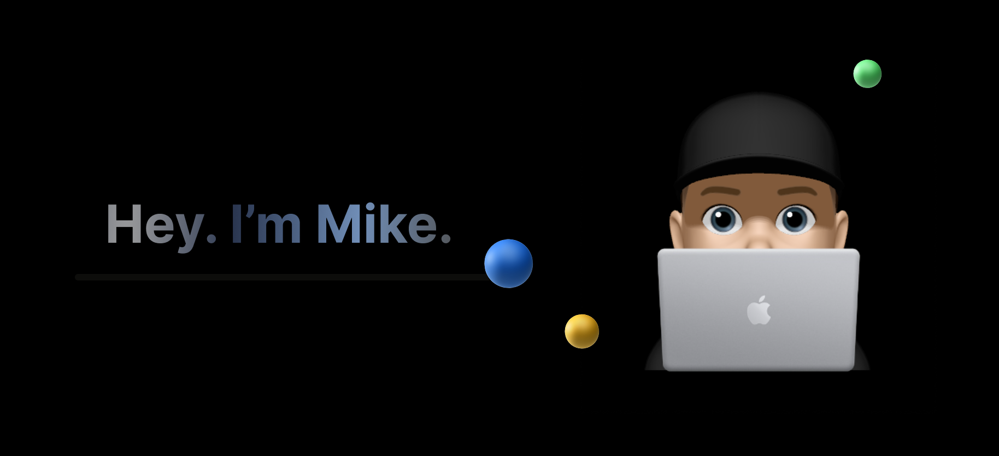

  

 

My background in large enterprise software sales has given me a rare look into how the world's largest companies adopt new technologies. I learned firsthand how innovative solutions reach market, drive real business impact, and scale through the enterprise. 

Today, I'm building at the intersection of AI and Customer Experience, focused on projects that will define the next chapter of CX in the AI era. 

<h4>...always open to connecting with fellow builders...</h4>
 

      

